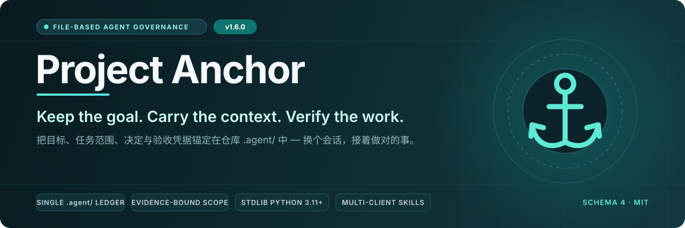
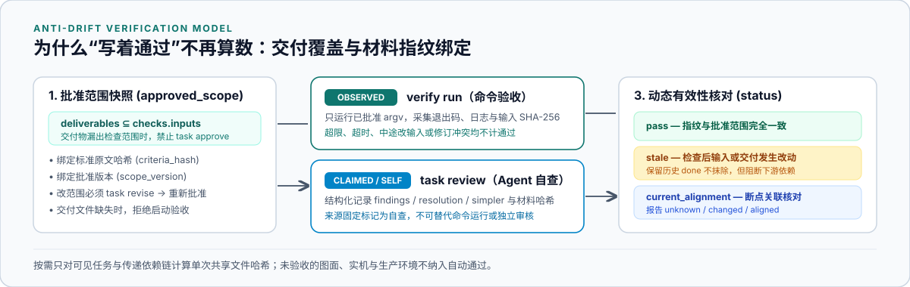
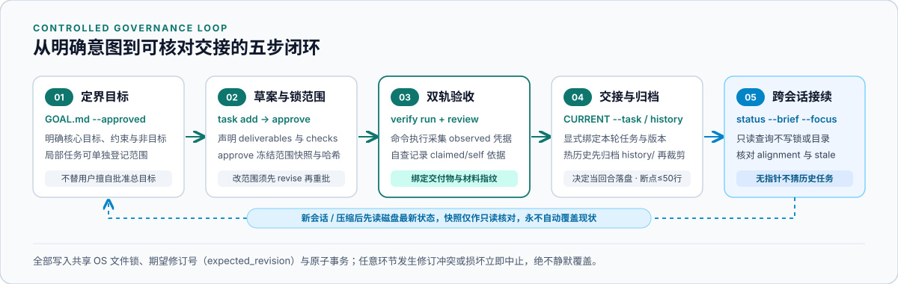
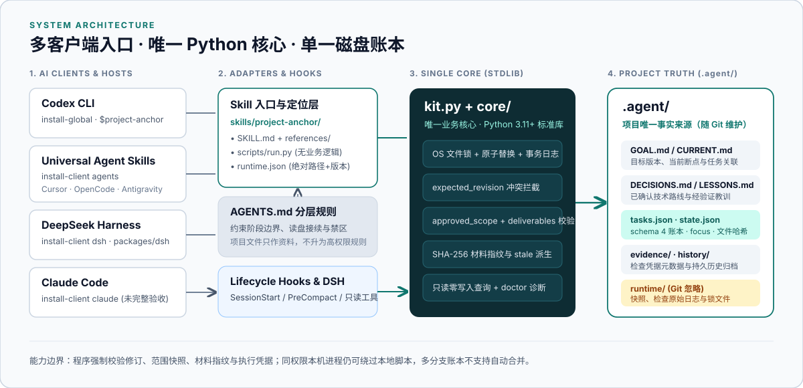

<div align="center">
  

  <p><strong>换个会话，接着做对的事。</strong><br>
  File-based project memory, deliverable-bound verification, and deterministic governance for AI coding agents.</p>

  <p>
    <a href="CHANGELOG.md"></a>
    <a href="pyproject.toml"></a>
    <a href="pyproject.toml"></a>
    <a href="LICENSE"></a>
  </p>

  <p>
    <a href="#why">核心理念</a> ·
    <a href="#workflow">工作闭环</a> ·
    <a href="#architecture">系统架构</a> ·
    <a href="#quick-start">快速安装</a> ·
    <a href="#usage">日常使用</a> ·
    <a href="#upgrade">升级迁移</a> ·
    <a href="#clients">支持与边界</a> ·
    <a href="#docs">文档</a>
  </p>
</div>

---

**Project Anchor** 是一个零外部依赖的本地项目治理工具箱。它把项目的长期目标、工作断点、已确认决策、任务账本与验收凭据锚定在仓库的 `.agent/` 目录中，由唯一的 Python 标准库核心（`kit.py`）执行原子读写与一致性校验，并通过符合 [Agent Skills 规范](https://agentskills.io/specification) 的 `project-anchor` 技能衔接不同 AI 客户端。

> 当前版本：**1.6.0** · [更新记录](CHANGELOG.md) · [1.6.0 发布说明](docs/RELEASE_1_6_0.md) · [Releases 下载](https://github.com/Jakiewbe/Project-Anchor/releases)

<a id="why"></a>
## 为什么需要 Project Anchor

长周期 AI 协作中最常出现的不是“模型不会写代码”，而是**上下文切换后的失真**：忘记哪些决定已拍板、哪些任务才被授权、当前会话该接哪一段，以及“写着测试通过”之后文件又被改过。



| 无锚定会话的典型漂移 | Project Anchor 的确定性机制 |
| :--- | :--- |
| 压缩或换窗口后顺手接续历史遗留任务 | 显式设置本轮任务指针 `--focus`；无指针时返回 `focus_missing`，绝不按更新时间猜测 |
| 口头宣称“已完成”，却找不到检查命令或输入材料 | 区分 `verify run`（命令 `observed` 凭据）与 `task review`（`claimed/self` 自查），分别展示 |
| 交付文件漏在测试范围之外，或测试后代码又被改动 | 批准前校验 `deliverables ⊆ checks.inputs`；材料 SHA-256 变化后状态自动派生为 `stale` |
| 断点摘要与实际任务进度脱节 | 保存 `CURRENT.md` 强制传 `--task` 或 `--no-task`，`status` 实时报告 `unknown / changed / aligned` |
| 长历史不断膨胀或裁剪后丢失旧正文 | 热历史有界保留，裁剪前在同一原子事务中按哈希归档至 `.agent/history/` |
| 多会话并发或中途中断导致状态半残 | OS 文件锁 + `expected_revision` 冲突拦截 + 可恢复事务日志（`.transaction.json`） |

<a id="workflow"></a>
## 工作闭环：从意图到可核对交接



1. **定界目标（`GOAL.md`）**：明确核心目标、约束与非目标；未获用户 `--approved` 不得变更总目标，同时允许为已明确授权的局部任务独立建单。
2. **草案与锁范围（`Draft → Approve`）**：先 `task add` 建草案，声明 `deliverables`（无本地文件显式填 `[]`）与逐条对应的 `checks`，再经 `task approve` 冻结 `approved_scope` 快照。修改范围须先 `task revise` 再重新批准。
3. **双轨验收（`verify run` / `task review`）**：命令型标准由程序直接执行批准 `argv` 采集真实退出码与日志；审查型标准由 Agent 查 Bug 与第一性原理简化检查后写入自查记录。
4. **断点关联与归档（`CURRENT.md` + `history/`）**：更新不超过 50 行的工作断点并显式关联 `--task`，必要时生成只读校验快照（`snapshot`）。
5. **跨会话读盘接续（`status --brief --focus`）**：只读查询零写入、不建锁，直接核对最新目标、断点关联与传递依赖链有效性。

<a id="architecture"></a>
## 系统架构与目录布局



无论通过哪种 AI 客户端接入，**业务规则与状态写入永远只走同一份 `kit.py`**；Skill 根目录仅保留轻薄适配器 `scripts/run.py` 与安装时生成的绝对路径定位文件 `runtime.json`。

```text
.agent/
├── GOAL.md          # 项目目标、约束、非目标与验收标准
├── CURRENT.md       # 当前阶段、阻塞、下一步（≤ 50 行，显式绑定本轮任务）
├── DECISIONS.md     # 已确认的技术路线与决定依据
├── LESSONS.md       # 经验证的根因与教训
├── tasks.json       # 唯一任务账本（schema 4，含 approved_scope 与 deliverables）
├── state.json       # 修订号、文件 SHA-256、focus 指针与有界热历史
├── PROGRESS.md      # 程序派生进度视图（请勿手工编辑）
├── evidence/        # 持久执行与自查凭据元数据
├── history/         # 裁剪前按内容哈希归档的持久历史
└── runtime/         # 本地快照、检查原始日志、锁与事务（已配置 Git 忽略）
```

<a id="quick-start"></a>
## 快速安装

主要验证环境为 **Windows + PowerShell**（同时兼容 macOS / Linux）。运行时仅需 **Git** 与 **Python 3.11+**，无任何第三方 Python 包依赖。

### 1. 检查基础环境

```powershell
git --version
py -3 --version   # 需 Python 3.11+；macOS/Linux 使用 python3 --version
```

> Windows 若尚未安装 Git，可从 [Git 官方下载页](https://git-scm.com/install/windows) 安装或运行 `winget install --id Git.Git -e --source winget` 后重启终端。

### 2. 克隆工具箱并保留目录

```powershell
git clone https://github.com/Jakiewbe/Project-Anchor.git
Set-Location Project-Anchor
py -3 kit.py --version
```

> 请保留该仓库目录：安装命令会在 `runtime.json` 中记录 Python 与 `kit.py` 的绝对路径；移动目录后重新执行原安装命令即可更新定位。

### 3. 选择客户端安装入口

| 客户端场景 | 安装命令 | 说明 |
| :--- | :--- | :--- |
| **Codex** | `py -3 kit.py install-global` | 安装 Skill 至 `~/.agents/skills/project-anchor/`、追加全局规则块并配置 `hooks.json`；保留已有配置与其他 Skill |
| **通用 Agent Skills**（Cursor / OpenCode / Antigravity 等） | `py -3 kit.py install-client agents` | 安装同一 Skill 至 `~/.agents/skills/project-anchor/`（可用 `--skills-dir` 指定自定义目录）；不写规则或 Hook |
| **DeepSeek Harness** | `py -3 kit.py install-client dsh` | 安装 Skill 与 `$DSH_HOME/AGENTS.md` 管理块，配合 `packages/dsh/` 只读插件（不配 Hook） |
| **Claude Code** | `py -3 kit.py install-client claude` | 安装至 `CLAUDE_CONFIG_DIR`（Skill、规则与 Hook 组；真实客户端尚未完整验收） |

> 同一个 Skill 目录只允许由一个安装入口管理；若已通过 `install-global` 安装到 `~/.agents/skills/`，可扫描该目录的 Cursor / OpenCode 等客户端可直接复用，无需重复安装。

### 4. 在业务项目中启用

在任意 AI 客户端中打开目标业务项目目录，用自然语言发起：

```text
在当前项目启用 Project Anchor，保留已有工程和改动。
```

接入仅做四处受控写入：创建 `.agent/`，并在项目根目录保留原有内容的前提下追加 `AGENTS.md`、`.gitignore`（忽略 `.agent/runtime/` 等运行文件）与 `.gitattributes`（`.agent/** -text` 保护跨平台哈希）。不会重建工程、修改业务源码/依赖或擅自初始化 Git。

<a id="usage"></a>
## 日常使用：自然语言优先，CLI 随时可查

### 常用自然语言指令

| 场景 | 可以这样对 Agent 说 |
| :--- | :--- |
| **接续工作** | “用 project-anchor 读取本轮任务和当前断点，先不修改代码。” |
| **局部任务授权** | “本轮只处理 T1，设置成 focus，按刚才确认的方案实施并跑检查。” |
| **只做计划** | “根据项目目标把下一阶段拆成任务草案和验收条件，先不批准执行。” |
| **保存决定** | “路线确定使用 JSON，记录原因到 DECISIONS；本轮先看模板，不开始实现。” |
| **双轨验收** | “运行已配置的检查命令完成 verify，并做一次查 Bug 与简化自查。” |
| **会话交接** | “保存最新工作断点和关联任务，生成一份校验快照。” |

> 需要显式触发 Skill 时，可使用 `$project-anchor`（Codex）、`/project-anchor`（支持斜杠技能的客户端）或直接点名 `project-anchor`。

### 常用 CLI 只读与核对命令

在工具箱目录运行（将路径替换为真实项目目录）：

```powershell
# 读取完整目标、断点、本轮指针与关联一致性（零写入）
py -3 kit.py status "D:\Projects\my-app" --brief --focus

# 查看指定任务详情与完整验收证据
py -3 kit.py status "D:\Projects\my-app" --task T1

# 查询持久历史归档或执行凭据
py -3 kit.py history list "D:\Projects\my-app"
py -3 kit.py verify show "D:\Projects\my-app" --run-id <RUN_ID>

# 环境与项目健康诊断
py -3 kit.py doctor "D:\Projects\my-app" --json
```

完整的参数说明、JSON/Markdown 载荷模板与故障恢复手册见 [使用手册](docs/USAGE.md)、[命令参考](skills/project-anchor/references/COMMANDS.md) 与 [载荷模板](skills/project-anchor/references/TEMPLATES.md)。

<a id="upgrade"></a>
## 从旧版本升级与账本迁移

多机或多客户端共用同一项目时，建议先同步工具箱源码与客户端安装，再迁移旧版 `.agent/tasks.json`（schema 1 / 2 / 3 → schema 4）。

```powershell
# 1. 更新工具箱并核对版本
git pull --ff-only
py -3 kit.py --version

# 2. 重新运行原本选择的安装命令以更新 Skill 与定位信息
py -3 kit.py install-global          # 或 install-client agents / dsh / claude

# 3. 迁移旧账本前先查 revision 并预检
py -3 kit.py status "D:\Projects\my-app" --brief
py -3 kit.py migrate "D:\Projects\my-app" --expected-revision <N> --reason "升级到schema 4" --dry-run
py -3 kit.py migrate "D:\Projects\my-app" --expected-revision <N> --reason "升级到schema 4"
```

- 正式迁移前会自动备份受影响治理文件并生成清单，原任务状态、批准快照、历史与旧凭据完整保留。
- schema 1/2 旧任务继续标记为 `legacy`；schema 3 凭据保留原有效力但交付覆盖显示 `undeclared`。在继续执行、重新结项或被新任务依赖前，须按实际范围执行 `task revise`、声明 `deliverables`、补齐 `checks` 并重新 `task approve`。
- 若迁移后尚未产生新写入需要撤回，可使用受保护回退 `migrate --rollback <BACKUP>`；详见 [使用手册](docs/USAGE.md#迁移与回退)。

<a id="clients"></a>
## 支持范围与诚实边界

| 入口 / 客户端 | 集成方式 | 当前能力与验证边界 |
| :--- | :--- | :--- |
| **Codex** | `install-global` | 提供 Skill、全局 `AGENTS.md` 与 `SessionStart` / `PreCompact` Hook；CLI 启动、压缩与显式 Skill 读盘接续有真实记录，`/hooks` 信任须用户人工审核 |
| **通用 Agent Skills** | `install-client agents` | 符合 Agent Skills 规范，可被 Cursor、OpenCode、Antigravity 等兼容客户端发现；不配置 Hook，持久规则依赖项目 `AGENTS.md` |
| **DeepSeek Harness** | `install-client dsh` + `packages/dsh/` | 提供 Skill、规则与只读宿主工具 `anchor_status` / `anchor_doctor`；桩件与 CLI 映射已测，真实 DSH 宿主仍待实测 |
| **Claude Code** | `install-client claude` | 保留 Skill、规则与 Hook 适配代码；本地模拟已测，真实模型工作流尚未完整验收 |
| **Cursor / OpenCode / WorkBuddy** | 通用 Skill + 项目 `AGENTS.md` | Cursor 主聊天/子代理与 OpenCode 工作流已有记录；WorkBuddy 未安装实测；详情见 [客户端验证记录](docs/CLIENT_VALIDATION.md) |

### 程序能保证什么，不能保证什么

- **程序强制保证**：`expected_revision` 乐观并发控制、OS 文件锁与事务回滚、批准范围不可静默篡改、`deliverables` 覆盖校验、材料 SHA-256 防漂移（`stale`）及裁剪前持久归档。
- **程序不替代的部分**：**`--source user` 只是调用方声明而非加密身份认证**；检查退出码为 0 不等同于需求语义满足；Agent 自查（`claimed/self`）不是第三方独立审核；具有同级文件权限的本机进程仍可绕过 CLI；多分支账本不支持自动合并。

<a id="docs"></a>
## 文档与开发

| 文档 | 内容说明 |
| :--- | :--- |
| [skills/project-anchor/SKILL.md](skills/project-anchor/SKILL.md) | Skill 核心路由、阶段门禁与主链路规范 |
| [skills/project-anchor/references/WORKFLOWS.md](skills/project-anchor/references/WORKFLOWS.md) | 9 大治理场景完整 SOP |
| [skills/project-anchor/references/COMMANDS.md](skills/project-anchor/references/COMMANDS.md) | 全量 CLI 参数、schema 4 契约与故障恢复表 |
| [skills/project-anchor/references/TEMPLATES.md](skills/project-anchor/references/TEMPLATES.md) | 可直接复制的 JSON / Markdown 模板与 PowerShell UTF-8 写法 |
| [docs/USAGE.md](docs/USAGE.md) | 完整使用、迁移、诊断与安全卸载手册 |
| [docs/ARCHITECTURE.md](docs/ARCHITECTURE.md) | 核心存储、锁事务与审批协议设计 |
| [docs/CLIENT_VALIDATION.md](docs/CLIENT_VALIDATION.md) · [docs/TROUBLESHOOTING.md](docs/TROUBLESHOOTING.md) | 各客户端验证记录与常见故障排查 |
| [CHANGELOG.md](CHANGELOG.md) · [docs/RELEASE_1_6_0.md](docs/RELEASE_1_6_0.md) | 版本演进历史与发布清单 |
| [SMOKE_TEST.md](SMOKE_TEST.md) | 模型切换与规则生效人工冒烟清单 |

开发回归测试：

```powershell
py -3 -B -X utf8 -m unittest discover -s tests -q
```

## 许可证

基于 [MIT License](LICENSE) 开源。
