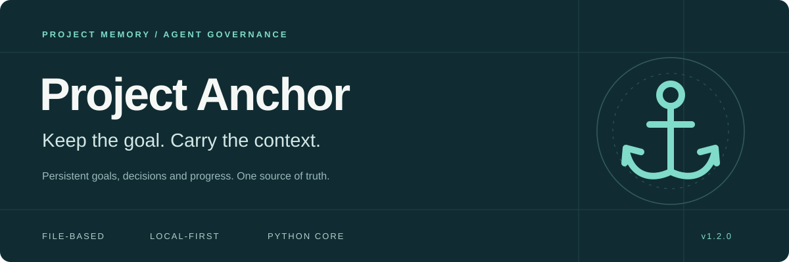
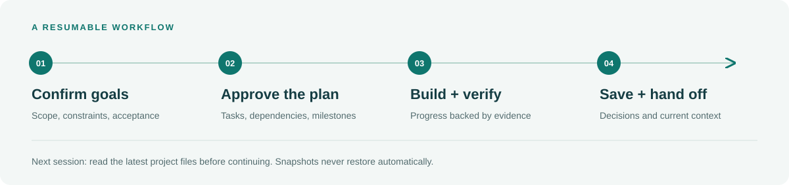
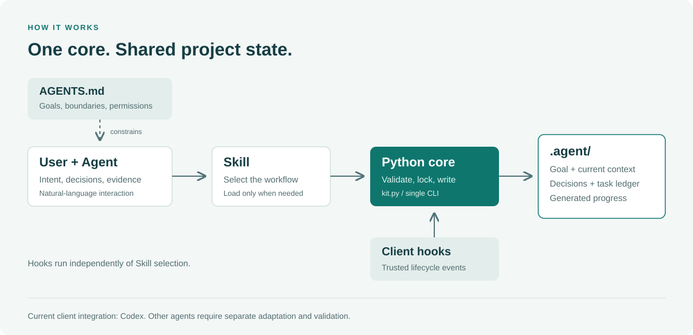

<div align="center">
  

  <p><strong>让 AI 项目的目标、进度和重要决定，换个会话也能接着用。</strong></p>
  <p>File-based project memory and governance for AI agents.</p>

  <a href="https://github.com/Jakiewbe/Project-Anchor/releases/tag/v1.3.0"></a>
  <a href="pyproject.toml"></a>
  <a href="pyproject.toml"></a>
  <a href="LICENSE"></a>

  <p>
    <a href="#why">功能</a> ·
    <a href="#quick-start">安装</a> ·
    <a href="#usage">日常使用</a> ·
    <a href="#upgrade">升级</a> ·
    <a href="#clients">客户端</a> ·
    <a href="#docs">文档</a>
  </p>
</div>

---

Project Anchor 为 AI 辅助开发保留一份**随项目保存、可以校验、可以通过 Git 维护的工作记录**。目标、任务、决策和断点写入项目的 `.agent/`；会话切换或对话压缩后，智能体可以重新读取这些记录，继续已确认的工作。

日常用自然语言表达需求，Skill 选择流程并调用同一套 Python 程序。项目规则约束行为，支持的客户端还可通过 Hook 在启动和压缩时提醒读盘、保存已有状态。它们各有职责，文件与程序检查不能保证模型每次都正确执行。

**当前版本：1.3.0** · [发布说明](https://github.com/Jakiewbe/Project-Anchor/releases/tag/v1.3.0) · [更新记录](CHANGELOG.md)

<a id="why"></a>
## 它能帮你做什么

| 长期项目中的问题 | Project Anchor 的处理方式 |
| :--- | :--- |
| 换会话后忘了最初目标 | 保存目标、约束、非目标和验收条件，接续时读取最新磁盘记录 |
| 不清楚哪些任务能开始 | 记录草案、批准、依赖和状态；明确的局部任务可以单独获批 |
| 讨论确定了路线，却没有记录 | 在允许治理写入时保存决定与原因，并区分记录决定和实施授权 |
| 看进度时被历史长记录淹没 | 简洁查询保留目标与断点，支持按明确任务或里程碑查看细节 |
| 重复更新制造无效修订 | 相同内容返回 `changed=false`，保留原修订、历史和完成时间 |
| 不确定安装与规则是否正常 | 诊断安装差异、文件完整性、Hook 配置及可核对的执行记录 |
| 项目结束后经验又丢了 | 保存已验证的教训，生成复盘草案，经确认后进入跨项目知识库 |

修改任务需要当前修订号，完成任务需要对应验收条件的证据。冲突、损坏和事务中断会明确报错，不自动覆盖其他会话的修改。提交、推送和知识入库由用户授权。

<a id="quick-start"></a>
## 快速开始

主要验证环境是 **Windows + PowerShell**。准备 **Python 3.11+**、Git，以及支持 Skill 发现和本地 Python 执行的 Agent。项目运行时只依赖 Python 标准库。

### 1. 获取工具箱

```powershell
git clone https://github.com/Jakiewbe/Project-Anchor.git
Set-Location Project-Anchor
py -3 --version
py -3 kit.py --version
```

### 2. 选择一种安装方式

**使用 Codex 集成：**

```powershell
py -3 kit.py install-global
```

安装用户级 Skill、全局规则管理块和工具自身的 Hook。其他 Skill 与非管理配置会保留，不修改 `config.toml`。在支持 Hook 的 Codex CLI 中打开 `/hooks`，审核 **SessionStart**、**PreCompact** 当前定义，再检查安装：

```powershell
py -3 kit.py doctor --native-hooks --native-skills
```

**使用通用 Agent Skills 入口：**

```powershell
py -3 kit.py install-client agents
py -3 kit.py doctor --client agents
```

这一路径安装同一份 Skill，不需要安装 Codex，也不配置客户端规则或 Hook。Agent 需支持扫描该 Skill 目录，并获得执行本地脚本的权限。

> 按原使用方式选择一个管理方。Codex 集成默认安装的 Skill 也位于 `~/.agents/skills/project-anchor/`；扫描该目录的其他 Agent 可以使用同一份安装，不必再执行 `install-client agents`。同名目录归属冲突时，安装器会拒绝覆盖。

Skill 的 `runtime.json` 指向实际 Python 和 `kit.py`，工具箱目录需要保留。安装路径、客户端差异和卸载方式见[使用手册](docs/USAGE.md)。诊断中的 `PASS`、`WARN`、`FAIL`、`UNVERIFIED` 分开报告；配置完成不代表实际行为已验收。

### 3. 在业务项目中启用

在 Agent 中打开你要处理的**业务项目目录**，说：

```text
在当前项目启用 Project Anchor 项目管理，保留已有工程和改动。
```

接入会创建 `.agent/`，并保留、追加 `AGENTS.md`、`.gitignore`、`.gitattributes` 中的治理约定。目标模板仍待用户确认；接入不会重建业务工程、修改依赖或自动初始化 Git。已有治理状态先读取，不重复初始化。

Codex 集成的全局规则会在明确项目的首次实际工作时检查接入。通用 Skill 按用户请求和已有规则运行；只读问答、限定文件修改或明确禁止治理写入时不自动接入。不要在用户主目录、磁盘根目录或工具箱目录中初始化业务项目。

需要显式调用时，Codex 可用 `$project-anchor`；支持斜杠入口的客户端可用 `/project-anchor`，也可以直接点名技能。

<a id="usage"></a>
## 日常怎么用



| 你想做什么 | 可以这样说 |
| :--- | :--- |
| 制定计划 | “根据项目目标制定任务草案，列出依赖和验收条件，先不执行。” |
| 处理局部任务 | “本次只修复这个问题，我已批准这个范围，不扩大到其他模块。” |
| 查看本轮进度 | “只查看里程碑 X 的任务、进度和阻塞，不修改状态。” |
| 保存决定 | “路线确定为 JSON，记录原因；这轮先看模板，不开始实现。” |
| 完成任务 | “将 T1 标记为完成，真实验收证据是……” |
| 切换会话 | “保存当前断点、已确认决定和下一步，准备换会话。” |
| 诊断或复盘 | “只检查安装与规则是否正常。”或“生成复盘草案，先不入库。” |

项目总目标与局部任务的批准分别记录。批准目标不等于要求生成计划，制定计划不等于批准实施；全部只读或限定修改文件时，不额外写治理记录。程序检查验收证据的结构与覆盖范围，真实结果仍需核对。

排错或独立查询时，在**工具箱目录**运行以下命令，将示例路径与任务 ID 换成自己的：

```powershell
py -3 kit.py status "D:\Projects\my-app" --brief
py -3 kit.py status "D:\Projects\my-app" --brief --milestone "本轮里程碑"
py -3 kit.py status "D:\Projects\my-app" --task T1
```

简洁查询保留完整目标和断点；不带 `--brief` 时可查看任务的验收条件与证据。筛选范围外的直接依赖单列，草案单独统计，不按更新时间猜测“当前任务”。

<a id="architecture"></a>
### 工作记录如何保留



| 组件 | 职责 |
| :--- | :--- |
| **Skill** | 理解当前意图、选择治理流程、调用程序 |
| **Python 核心** | 校验修订和状态，执行锁、事务、快照及诊断 |
| **项目规则** | 约束范围、授权和状态维护 |
| **Hook** | 在已有支持与执行证据的客户端事件中运行 |

项目的 `.agent/` 保存 `GOAL.md`（目标）、`CURRENT.md`（断点）、`DECISIONS.md`（决定）、`LESSONS.md`（教训）和唯一任务账本 `tasks.json`。`PROGRESS.md` 由账本生成，`state.json` 保存哈希与修订；运行日志和快照位于不提交 Git 的 `runtime/`。

重要决定需先通过程序保存，Hook 无法恢复尚未落盘的聊天决定。压缩前的快照只保存已有状态；接续时以当前磁盘记录为准，不自动用旧快照覆盖新状态。Hook 绑定会话工作目录，不能把 A 项目的事件当成 B 项目的保护已执行。

<a id="upgrade"></a>
## 更新已有安装

在工作区干净的工具箱 `main` 分支中获取更新：

```powershell
git status --short
git pull --ff-only origin main
```

随后重新执行首次安装时选择的**同一条安装命令**：Codex 集成用 `py -3 kit.py install-global`，通用入口用 `py -3 kit.py install-client agents`，再运行对应的 `doctor`。移动目录或换电脑后，也需要重新安装定位信息。

**升级到 1.3.0 不需要迁移旧项目。** 默认 `status`、原 `PROGRESS.md` 统计口径和 `schema 1` 保持兼容。安装器校验管理文件并创建更新备份；遇到人工修改或归属冲突时停止，不覆盖。Hook 当前定义的信任仍通过客户端原生入口核对。

固定版本可从 [v1.3.0 发布页](https://github.com/Jakiewbe/Project-Anchor/releases/tag/v1.3.0)获取源码；各版本变化见 [CHANGELOG](CHANGELOG.md)。

<a id="clients"></a>
## 客户端与能力边界

| 入口 | 安装与接续方式 | 范围 |
| :--- | :--- | :--- |
| 通用 Agent Skills | 同一 Skill 调用 `kit.py`，读取 `.agent/` | 需支持 Skill 发现、本地 Python 执行及相应权限 |
| Codex 集成 | `install-global`，Skill、规则和 Hook | 生命周期能力按真实客户端和事件证据声明 |
| Cursor / OpenCode | 通用 Skill 与项目规则 | 本工具不配置其生命周期 Hook；效果以对应验证记录为准 |
| Claude Code | 已提供 `install-client claude` 专用入口 | 真实客户端未完整验证，具体安装见使用手册 |
| WorkBuddy | 通用 Skill 入口 | 发现目录与脚本权限需按客户端确认，未完成真实验收 |

<a id="validation"></a>
自动选择 Skill、及时保存决定和长期遵守规则仍依赖 Agent 的实际行为。文件存在、Hook 配置、信任、脚本执行和模型遵从是不同层级；不能将一项通过扩大为所有客户端、Desktop/IDE 或多轮压缩均可靠。详细机制见[客户端说明](skills/project-anchor/references/CLIENTS.md)，具体证据见下方验证文档。

<a id="docs"></a>
## 文档与开发

| 文档 | 内容 |
| :--- | :--- |
| [发布说明](https://github.com/Jakiewbe/Project-Anchor/releases/tag/v1.3.0) · [更新记录](CHANGELOG.md) | 当前版本及历史变化 |
| [使用手册](docs/USAGE.md) | 安装、任务证据、备份、迁移、卸载和恢复 |
| [Skill 工作流](skills/project-anchor/references/WORKFLOWS.md) · [CLI 参数](skills/project-anchor/references/COMMANDS.md) | 自然语言流程与命令输入 |
| [1.3.0 验证记录](docs/ITERATION_1_3_VALIDATION.md) · [客户端验证](docs/CLIENT_VALIDATION.md) | 实测范围、失败与未验证事项 |
| [架构说明](docs/ARCHITECTURE.md) · [故障排查](docs/TROUBLESHOOTING.md) | 实现约束及错误处理 |
| [冒烟检查](SMOKE_TEST.md) | 规则或客户端变更后的核对方法 |

所有入口复用 `kit.py` 和 `core/`，Skill 位于 `skills/project-anchor/`，自动化检查在 `tests/`。运行回归：

```powershell
py -3 -X utf8 -m unittest discover -s tests -q
```

开发改动需检查差异并执行相关验证。认证信息、密钥、原始会话日志和本地运行数据不应提交。

## 许可证

[MIT License](LICENSE)
